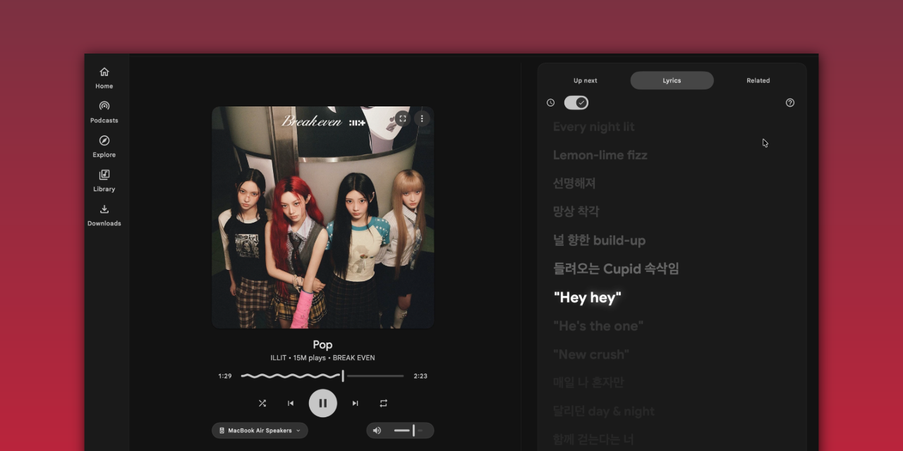

<p align="center">
  
</p>

<p align="center">
  Official native desktop client for <a href="https://github.com/EchoMusicApp/Echo-Music"><strong>Echo Music</strong></a>, built in Go with hardware-accelerated rendering and zero Electron overhead.
</p>

<p align="center">
  <a href="https://desktop.echomusic.fun/">Website</a> ·
  <a href="https://github.com/EchoMusicApp/Desktop/releases/latest">Latest Release</a> ·
  <a href="https://github.com/EchoMusicApp/Echo-Music">Echo Music Android</a> ·
  <a href="https://support.iad1tya.cyou/">Support</a>
</p>

---

## Overview

**Echo Music Desktop** brings the ad-free YouTube Music experience from [Echo Music](https://github.com/EchoMusicApp/Echo-Music) natively to **macOS**, **Windows**, and **Linux**. Written in Go using `mygo`, it launches quickly, uses minimal memory, and integrates deeply with desktop surfaces like the MacBook notch, menu bar / system tray, Discord Rich Presence, and a local MCP server.

### Screenshots

| Full-Screen 3D Album Art | Full-Screen Synced Lyrics |
| :---: | :---: |
|  |  |


---

## Features

- **Native Go + Hardware UI**: Compiled native binary with GPU-accelerated rendering and fast cold starts across macOS, Windows, and Linux.
- **MacBook Notch & Menu Bar Players**: Compact dynamic notch island with a wavy progress scrubber and live lyric line, plus a menu bar / tray mini player with Up Next queue controls.
- **Full-Screen 3D Art & Synced Lyrics**: Switch between cursor-reactive 3D tilted album art with specular highlight and big left-aligned synced lyrics with click-to-seek navigation.
- **Podcasts & Library Workspace**: Browse podcast shows, episodes, Explore, Home, Library, and Downloads from a unified left navigation rail and `⌘K` search bar.
- **10-Band Equalizer & Audio Controls**: Real-time 10-band EQ (`31 Hz – 16 kHz`) with presets, loudness normalization, configurable track crossfade, playback speed, and audio output switching.
- **Material You & Dynamic Themes**: Monochrome, Tonal Spot, Vibrant, Expressive, and Gradient Aurora palettes with album artwork color extraction and Matugen support.
- **Offline Cache, Downloads & Listening Stats**: Automatic song caching, offline track downloads, on-device listening history & stats, Discord Rich Presence, and local MCP AI control.
- **Release Update Notifications**: Checks `EchoMusicApp/Desktop` release tags and opens [`desktop.echomusic.fun/update`](https://desktop.echomusic.fun/update) when a newer version is available.

---

## Downloads

Prebuilt installers and packages are published directly on [GitHub Releases](https://github.com/EchoMusicApp/Desktop/releases/latest) and on [desktop.echomusic.fun](https://desktop.echomusic.fun/):

| Platform | Architecture | Formats |
| --- | --- | --- |
| **macOS** | Apple Silicon (`arm64`) / Intel (`amd64`) | `.dmg` |
| **Windows** | `x64` (`amd64`) | `-setup-.exe`, `.zip` (Portable) |
| **Linux** | `x86_64` (`amd64`) / `arm64` | `.AppImage`, `.deb`, `.rpm`, `.tar.gz`, `.flatpak` |

---

## Keyboard Shortcuts

| Action | Shortcut |
| --- | --- |
| Search songs, albums, artists, podcasts | `⌘K` / `⌘F` (or `Ctrl+K` / `Ctrl+F`) |
| Home / Explore / Library | `⌘1` / `⌘2` / `⌘3` |
| Open Settings | `⌘,` |
| Refresh view | `⌘R` |
| Close player panel / Full screen | `Esc` |
| Zoom in / out / reset | `⌘=` / `⌘-` / `⌘0` |

---

## Building from Source

### Prerequisites

- **Go** `1.27+` (see [go.mod](./go.mod))
- `curl`, `tar`, and `unzip` for fetching bundled playback tools (`yt-dlp`, `ffmpeg`, `QuickJS`)

### Steps

1. **Clone the repository**
   ```bash
   git clone https://github.com/EchoMusicApp/Desktop.git
   cd Desktop
   ```

2. **Fetch platform media tools** *(optional for minimal builds that rely on system `PATH`)*
   ```bash
   ./scripts/fetch-tools.sh darwin-arm64
   # Supported: darwin-arm64, darwin-amd64, windows-amd64, linux-amd64, linux-arm64
   ```

3. **Run tests**
   ```bash
   go test ./...
   ```

4. **Build the desktop bundle**
   ```bash
   go tool mygo build -platform darwin/arm64
   ```
   Output artifacts are written to `build/` (configured in [mygo.json](./mygo.json)).

---

## Privacy & Security

- **Privacy**: See [docs/PRIVACY.md](./docs/PRIVACY.md) for details on what stays local on your device and how the optional anonymous install ping works.
- **Security**: See [SECURITY.md](./SECURITY.md) for vulnerability reporting instructions.
- **Contributing**: See [CONTRIBUTING.md](./CONTRIBUTING.md) for development setup and pull request guidelines.

---

## Support

- **Support development**: [support.iad1tya.cyou](https://support.iad1tya.cyou/) · [Buy Me a Coffee](https://buymeacoffee.com/iad1tya) · [GitHub Sponsors](https://github.com/sponsors/iad1tya)

---

## Credits & Upstream

**Echo Music Desktop** is forked from and built upon **[Meiro](https://github.com/elianiva/meiro)** by **[Dicha Zelianivan Arkana (`elianiva`)](https://github.com/elianiva)**. Special thanks to `@elianiva` for creating Meiro and the native Go + `mygo` desktop foundation that made this project possible.

- **Upstream Desktop Base**: [github.com/elianiva/meiro](https://github.com/elianiva/meiro)
- **Echo Music Mobile App**: [github.com/EchoMusicApp/Echo-Music](https://github.com/EchoMusicApp/Echo-Music)

---

## License & Legal

- **License**: This project is licensed under the **GNU General Public License v3.0 (GPL-3.0)** — see [LICENSE](./LICENSE). In accordance with GPL-3.0, upstream copyright and license notices are preserved, and any redistributed or modified versions must also be licensed under GPL-3.0.
- **No Affiliation / Trademark Notice**: Echo Music Desktop is an independent open-source project and is **not affiliated with, endorsed by, or sponsored by YouTube, YouTube Music, Google LLC, or Alphabet Inc.** "YouTube" and "YouTube Music" are trademarks of Google LLC; all album artwork, audio streams, and metadata belong to their respective copyright holders.
- **User Responsibility**: By using this software, you agree to comply with YouTube's Terms of Service and all applicable copyright laws in your jurisdiction.
- **Third-Party Tools**: Optional bundled media utilities include `yt-dlp` (Unlicense), `FFmpeg` (LGPL/GPL), and `QuickJS` (MIT).
